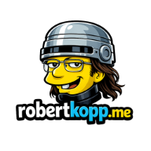

[English](README.md) · **Deutsch**

# Über mich

## Hallo, ich bin Christoph.

Ich bin gelernter IT-Systemelektroniker und mache derzeit eine Umschulung zum Fachinformatiker für Anwendungsentwicklung. Ich möchte verstehen, wie Systeme funktionieren, und Wege finden, Hardware und Software miteinander zu verbinden.

## Eine praktische Grundlage in Elektronik und IT

2003 habe ich meine Ausbildung zum IT-Systemelektroniker bei Siemens mit dem IHK-Abschluss beendet. Danach habe ich Brand- und Einbruchmeldeanlagen geplant, programmiert, installiert und gewartet, darunter Kameras, Einbruchsensoren, akustische Sensoren und jede Art von Feuermelder.

Außerdem habe ich Starkstromleitungen für schwere Maschinen geprüft sowie elektrische Prüfungen und Fehlerdiagnosen durchgeführt. Neben meiner beruflichen Tätigkeit habe ich weiterhin PCs gebaut, Heimnetzwerke eingerichtet und Familie und Freunden bei IT-Problemen geholfen.

Diese Erfahrung prägt meine Herangehensweise: das System verstehen, die Ursache untersuchen und prüfen, ob eine Änderung tatsächlich funktioniert.

## Ein neuer beruflicher Weg in der Softwareentwicklung

Ein Arbeitsunfall und gesundheitliche Vorbelastungen haben mich zu einer beruflichen Neuorientierung veranlasst. Seit Juni 2025 mache ich bei der Deutschen Angestellten-Akademie in Gelsenkirchen eine Umschulung zum *Fachinformatiker für Anwendungsentwicklung*.

Die zweijährige Umschulung umfasst ein Praktikum und ein Projekt für die IHK-Abschlussprüfung. Ich möchte mein Wissen in einem Entwicklungsteam anwenden, an echten Projekten mitarbeiten und alltägliche Entwicklungsprozesse kennenlernen.

## Lernen durch Bauen und Testen

Ich erarbeite mir Grundlagen in Python, C#, JavaScript, HTML/CSS und SQL sowie in objektorientierter Programmierung, Entwurfsmustern und Softwareentwicklung. Ich arbeite mit Visual Studio und VS Code und habe Erfahrung mit Windows, Windows Server, Linux und Docker.

Open-Source-Software und Hardware interessieren mich besonders. In einem Umschulungsprojekt habe ich mit der Automatisierung eines PiCrawler-Roboters experimentiert und Beschleunigungs-, Gyroskop- und LiDAR-Sensoren sowie Mikroschalter ergänzt. Dabei ging es um Hindernisvermeidung, Orientierung und die Erkennung des Bodenkontakts der Roboterbeine.

Ich nutze auch KI-Werkzeuge zum Lernen, zur Codeanalyse und zur Fehlersuche. Meine PlayStation-Patches, MiSTer- und Mikrocontroller-Projekte zeigen, wie sich diese Unterstützung mit praktischen Tests und Überprüfung verbinden lässt.

## Wo Hardware auf Software trifft

Zu meinen Interessen gehören Mikrocontroller, Spieleprogrammierung, 3D-Druck, CNC und Laserschneiden. Meine Projekte verbinden diese Themen: Steuerungspatches für klassische Spiele, MiSTer-Experimente, Controller-Firmware und eine lokale LAN-Party-Plattform.

Ich dokumentiere sowohl den Weg als auch die Ergebnisse, einschließlich der bereits geprüften Funktionen und offenen Aufgaben.

## Meine Projekte auf GitHub

- [DukeNukem-PSX-TTK-LOTB-modern-controls](https://github.com/Bertzerker/DukeNukem-PSX-TTK-LOTB-modern-controls) — Moderne DualShock-Steuerung für Duke Nukem auf der PlayStation.
- [Die-Hard-Trilogy-PSX-DH1-DH2-fixes](https://github.com/Bertzerker/Die-Hard-Trilogy-PSX-DH1-DH2-fixes) — Lightgun- und UI-Korrekturen für Die Hard Trilogy auf der PlayStation.
- [MiSter-Ikemen](https://github.com/Bertzerker/MiSter-Ikemen) — IKEMEN-GO-Port für ARMv7 auf MiSTer Frontier.
- [BT-GP2350B-Plus-W-CE](https://github.com/Bertzerker/BT-GP2350B-Plus-W-CE) — Firmware für Bluetooth-Controller.
- [PiZero-HID-Bridge](https://github.com/Bertzerker/PiZero-HID-Bridge) — USB-HID-Bridge auf einem Raspberry Pi Zero 2 W mit Weboberfläche.
- [LISP](https://github.com/Bertzerker/LISP) — Lokale LAN-Party-Plattform mit Spielservern, Downloads, Chat, Forum und Turnieren.
- [VirtualHere-Control](https://github.com/Bertzerker/VirtualHere-Control) — Steuerungs- und Einrichtungstool für VirtualHere.
- [Application-Catapult](https://github.com/Bertzerker/Application-Catapult) — Bewerbungsentwürfe für Thunderbird, LibreOffice-PDFs und optionale KI-Unternehmenssuche.

## Links

- [GitHub · Bertzerker](https://github.com/Bertzerker)
- [Website · robertkopp.me](https://robertkopp.me)
- [Kontakt](https://robertkopp.me/contact/)

---

Aus Neugier entstanden. Auf GitHub geteilt.

[English](README.md) · **Deutsch**
